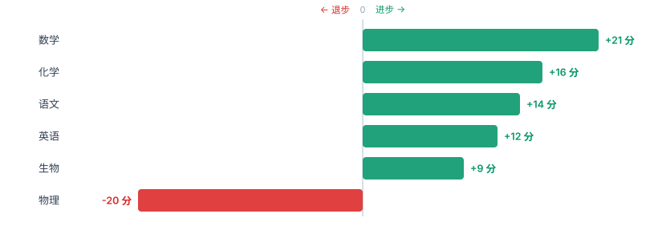
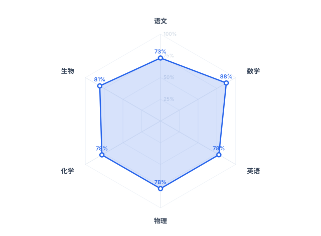
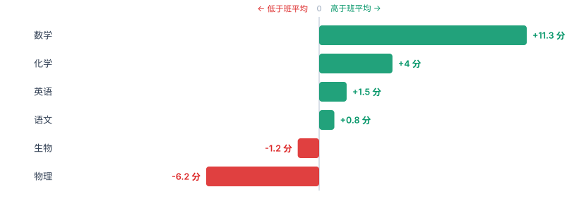

# 成绩雷达 · ScoreRadar

[](https://github.com/ATYC1314/score-radar/actions/workflows/test.yml)
[](LICENSE)
[](https://atyc1314.github.io/score-radar/)

> **总分在涨，物理在崩——雷达帮你提前发现。**

把成绩表粘贴进去，它画出趋势图，并用中文告诉你哪一科正在悄悄往下掉。

不需要安装任何东西，不需要联网，数据全部在你自己的电脑上处理。

### 👉 [**点这里直接打开在线版**](https://atyc1314.github.io/score-radar/)（不用下载，打开就能用）


---

## 为什么要做这个

大部分学生看成绩的方式是：**只看总分和排名**。

但总分是最会骗人的东西。总分涨了 50 分，可能是因为数学猛涨了 30 分，同时物理已经连着掉了 20 分——而后者才是真正需要你立刻处理的事。等到总分终于被物理拖下来的时候，一个学期已经过去了。

这个工具就是为了解决这一件事：**把"总分涨了"拆开，指出究竟是哪一科在退步、退了多久、退了多少。**

比如上面那张截图里，它给出的结论是：

> **总分趋势**：从《高二上月考1》到《高二下月考2》，总分上升 52 分（567 → 619）。平均每次考试上升约 10.8 分。
>
> **物理 连续下滑 5 次**：从《高二上月考1》的 88 分，一路掉到《高二下月考2》的 68 分，共 20 分。连续下滑通常不是「没学好」，而是某个具体章节卡住了，建议优先排查。
>
> **数学 最不稳定**：去掉整体趋势后，得分率上下抖动最大（波动 3 个百分点，最好 95%，最差 79%）。忽高忽低往往比一直低分更值得先解决——它说明你会做，只是不稳。

总分在涨，但物理在崩——这就是只看总分绝对发现不了的东西。

### 它一共会检查这几类问题

| 检查 | 说明 |
|---|---|
| **总分趋势** | 整体在涨还是在跌，平均每次考试变化多少分 |
| **连续下滑** | 某科连续多次退步（中间缺考会打断连续性） |
| **进步最大** | 哪一科涨得最快，把这套方法复制到别科 |
| **最不稳定** | 去掉整体趋势后上下抖动最大的科目——会做但不稳 |
| **最强 / 最弱科目** | 按得分率公平比较，满分不同的科目也能比 |
| **低于及格线** | 平均得分率跌破 60%，并换算成"平均每次少拿多少分" |
| **下次考试预测** | 按趋势线往后推一格，给出一个带浮动范围的估算 |
| **哪科还会继续掉** | 按趋势推算，点名最危险的那一科 |
| **领先 / 落后班平均** | 你和班级整体差最多的是哪两科（需要填「班级平均」行） |
| **数据质量** | 考试次数够不够、有几处缺考 |

每一条都会配一句人话解释，而不是只丢给你一个数字。

**关于预测，有一句话要说清楚**：它只是把最近几次的趋势往后延长一格，**不是算命**。
换个学习方法，这条线立刻就会变。所以预测卡片里写的是一句提醒，而不是一个"你下次会考 XX 分"的断言。

---

## 快速开始

**方式一：直接在线用（推荐，什么都不用装）**

👉 **<https://atyc1314.github.io/score-radar/>**

打开就能用，也可以把这个网址发给同学。

**方式二：下载到本地用（断网也能用）**

1. 下载这个项目（点右上角绿色的 **Code → Download ZIP**，解压）
2. **双击 `index.html`**
3. 三种导入方式，挑最顺手的：
   - 从 Excel 里选中成绩区域，`Ctrl+C`，粘贴进文本框
   - 点「打开 CSV 文件」
   - **直接把 CSV 文件拖到页面上**
4. 点「开始分析」

就这样，没有第 5 步。不用装 Python，不用装 Node，不用敲命令行。

> 两种方式效果完全一样。因为整个工具只有一个网页文件，所有计算都在你的浏览器里完成——**在线版也不会把你的成绩传到任何服务器**。

**文件编码不用管。** Excel 在中文 Windows 上存出来的 CSV 是 GBK 编码，
很多工具打开都是乱码；这里会自动识别 UTF-8、带 BOM 的 UTF-8、GBK、UTF-16，
并在界面上告诉你它检测到了什么。

---

## 成绩表要写成什么格式

第一行是表头，之后每一行是一次考试，**按时间从早到晚排列**。

```
考试,语文,数学,英语,物理,化学,生物
满分,150,150,150,100,100,100
班级平均,108,120,115,84,74,82
高二上月考1,102,118,112,88,72,75
高二上期中,108,126,109,84,70,78
高二上月考2,105,135,115,79,76,82
高二下月考1,112,128,118,76,79,80
高二下期中,110,142,121,72,83,86
高二下月考2,116,139,124,68,88,84
```

分隔符用 **Tab、逗号、中文逗号、或两个以上空格** 都可以，程序会自动识别——所以你直接从 Excel 复制粘贴（Tab 分隔）就行，不用手动改成逗号。

**「满分」和「班级平均」这两行都是可选的，但强烈建议填：**

- 填**满分**：语文满分 150、物理满分 100，直接比原始平均分是不公平的。填了才能算「得分率」，
  从而公平地跨科比较，并解锁最强/最弱科目排名、稳定性分析、**雷达图**。
- 填**班级平均**：能看到每科比班平均高多少、低多少，知道自己大概在班里什么位置，
  并解锁**「与班级平均的差距」图**。

这两行的顺序无所谓，写「满分」前面或后面都能认。

如果某一科**缺考，就把那一格留空**，不要写 0 分。程序会跳过它，并把折线断开——0 分会把趋势彻底带偏。

---

## 图表

分析完会生成六张图：

**各科趋势** —— 一眼看出哪条线在往下走。点科目名可以单独隐藏/显示某几科，方便只看你关心的。


**各科平均得分率** —— 公平地横向比较各科强弱（已按满分折算）。


**总分趋势** —— 整体走势，每个点标出具体分数。


**进步 / 退步排行榜** —— 双向条形图，0 在正中间，往右绿色是进步、往左红色是退步。
普通条形图里"涨 12 分"和"跌 12 分"都是"一条 12 长的条"，方向信息会丢，这个不会。



**各科得分率雷达图** —— 看的是「形状」：哪一科凸出来、哪一科凹进去，一眼看出偏不偏科。
折线图回答"随时间怎么变"，雷达图回答"此刻是什么样"，两者互补。



**与班级平均的差距** —— 填了「班级平均」这一行才有。同样是双向图，一眼看出哪科在拖后腿。



---

## 导出图片和报告

**在网页上直接导出**（最简单，不需要装任何东西）：

分析完滚到页面底部，有四个按钮：

| 按钮 | 得到什么 |
|---|---|
| 下载完整报告（HTML） | 一个自包含的网页报告，没有任何外部依赖，拷到别的电脑上双击就能看，也能直接发给同学或老师 |
| 导出总分趋势图（PNG） | 2 倍分辨率的图片，插进 Word / PPT 不糊 |
| 导出各科趋势图（PNG） | 同上 |
| 导出排行榜（PNG） | 同上 |
| 导出进步退步图（PNG） | 同上 |
| 导出雷达图（PNG） | 同上（需要先填「满分」行） |

> 为什么选 PNG 而不是 JPG？因为成绩图里有大量文字和细线，
> JPG 的压缩会让文字边缘发虚，PNG 是无损的。

**用命令行导出**（想要矢量图，或者批量处理时用）：

```bash
node tools/export-svg.js sample-data.csv out
```

它会在 `out/` 目录下生成最多 6 个 SVG 矢量图和一份 HTML 报告：

- `总分趋势.svg`、`各科趋势.svg`、`各科得分率.svg` —— **矢量图**，无限放大都不糊
- `进步退步.svg`、`各科雷达图.svg`、`与班级平均的差距.svg` —— 后两个取决于你有没有填对应的行
- `分析报告.html` —— 和网页上导出的是同一份，因为共用同一个函数
- 同时会在终端里把诊断结论打印一遍

需要先装 [Node.js](https://nodejs.org/)（只有这个功能需要，日常使用不需要）。

---

## 它是怎么工作的

```
score-radar/
├── index.html                 界面（打开这一个文件就能用）
├── core.js                    核心逻辑：解析 → 统计 → 诊断 → 画图 → 报告
├── test.js                    自动测试（189 项）
├── CHANGELOG.md               更新日志
├── sample-data.csv            示例数据
├── .github/workflows/
│   ├── test.yml               每次推送自动跑测试（Node 18/20/22/24）
│   └── release.yml            推标签自动发版（测试不过就不发）
├── tools/
│   ├── export-svg.js          命令行导出矢量图和报告
│   └── changelog-notes.js     从 CHANGELOG 抽取发行说明
└── docs/                      README 用到的图片
```

`core.js` 里没有任何界面代码，只有纯函数。主要的是这几个：

| 函数 | 干什么 |
|---|---|
| `parseTable(text)` | 把粘贴的文本变成数据，自动识别分隔符、全角数字、缺考空格、满分/班级平均行 |
| `decodeBytes(bytes)` | 判断文件是 UTF-8 / GBK / UTF-16，中文不乱码的关键 |
| `trendStats(values)` | 算趋势：涨了多少、斜率、残差标准差、连续下滑、**下次预测** |
| `diagnose(dataset)` | 把上面那些数字翻译成人话（10 类结论） |
| `rankingItems(ds)` | 各科平均分/得分率排行榜 |
| `changeRankingItems(ds)` | 进步退步排行榜 |
| `classGapItems(ds)` | 与班级平均的差距 |
| `lineChartSVG(opt)` | 手写 SVG 画折线图 |
| `barChartSVG(opt)` | 手写 SVG 画条形图 |
| `divergingBarChartSVG(opt)` | 双向条形图（0 在中间，左右分别是正负） |
| `radarChartSVG(opt)` | 雷达图 |
| `buildReportHTML(ds)` | 生成自包含的 HTML 报告 |

**全部图表都是手写 SVG，不依赖任何第三方图表库。**
整个项目 **零依赖**——没有 npm 包，没有 CDN，没有构建步骤。所以十年后它大概率还能跑。

### 四个值得一提的细节

**「连续下滑」必须是真的连续。** 如果中间缺考一次，那就不算连续——中间那一格是空的，你根本不知道到底涨了还是跌了，凭什么说它连续下滑？

**「不稳定」不能用普通标准差判断。** 一个一路匀速下滑的科目，它的标准差也很大，但它显然不是"忽高忽低"，而是"一直在退步"。所以这里用的是**残差标准差**（去掉整体趋势之后剩下的抖动），这样才能把这两件事分开。这个 bug 在开发时真的踩过，现在由 `test.js` 里的回归测试守着。

**「预测」用回归线，不用「最后一个值 + 斜率」。** 因为最后一次考试可能是一次偶然的高分或低分，从它出发往外推，等于把这次的运气也一起放大出去。回归线用的是全部数据，对单次波动没那么敏感。少于 3 次考试干脆不给预测——两个点必定落在一条直线上，"预测"就变成了复读。

**「文件编码」不能问用户。** 中文 Windows 上 Excel 存出来的 CSV 是 GBK，用户根本不知道"编码"是什么，问他等于没问。所以这里先用 `fatal: true` 严格解码 UTF-8，抛错了就说明不是 UTF-8，自动改用 GBK——**不需要用户做任何选择**。

---

## 开发

项目只有一个依赖要求：Node.js（用来跑测试）。核心逻辑本身不需要任何东西。

```bash
node test.js
```

```
全部通过： 189 项
```

测试覆盖了：解析各种格式、全角数字、缺考处理、连续下滑的识别、残差标准差的正确性、及格线预警的边界、**文件编码识别**（GBK 那条测试的字节是用 Python 的 gbk 编码器取的真值，不是猜的）、**预测的边界**（少于 3 个点不预测、异常值不会被放大）、**班级平均行的解析**（和满分行任意顺序都能认、缺一格就整体作废）、**双向条形图的标签几何**、**雷达图的多边形数量与超值夹取**、报告生成的自包含性与安全转义、SVG 转义（防止科目名里的 `<` 破坏图片）、以及几个曾经踩过的坑。

另外还有一个**界面冒烟测试**（20 项）：用无头浏览器真的打开 `index.html`、真的调用导出函数、把导出的 PNG 重新读回来数像素确认它不是一张白图。因为"导出图片"这种事最阴险的地方在于——坏掉了页面依然正常显示，只是你点了按钮没反应，光读代码是发现不了的。

---

## 已知限制 / 可以做但还没做的

欢迎提 Issue 或 PR。这些是已知可以做但还没做的事：

- [ ] **导入 Excel (.xlsx)** —— 目前要复制粘贴，或者先存成 CSV（GBK 已经没问题了）
- [ ] **知识点维度** —— 现在只能按科目，没法细分到"函数"、"电磁感应"这种章节
- [ ] **记住上次的数据** —— 现在关掉页面就没了（不想用 localStorage 存隐私数据，需要想个更好的方案）
- [ ] **多个学生横向对比** —— 目前的「班级平均」只有一列，还看不了具体的几个人

已经做完的（在 [CHANGELOG.md](CHANGELOG.md) 里）：

- [x] **导出成图片** —— v0.2.0 起网页上就能一键导出 2 倍分辨率的 PNG
- [x] **拖拽导入** —— v0.2.0
- [x] **自动识别文件编码** —— v0.2.0
- [x] **成绩预测** —— v0.3.0
- [x] **和班级平均对比** —— v0.3.0
- [x] **进步 / 退步排行榜** —— v0.3.0
- [x] **得分率雷达图** —— v0.3.0

---

## 隐私

这个工具**没有任何网络请求**。没有统计代码，没有 CDN，没有后端服务器。你的成绩数据从头到尾只存在于你自己的浏览器里。

你可以自己按 `F12` 打开开发者工具，切到 Network 面板，会看到它是空的。

---

## License

[MIT](LICENSE) —— 随便用，随便改，随便商用。
