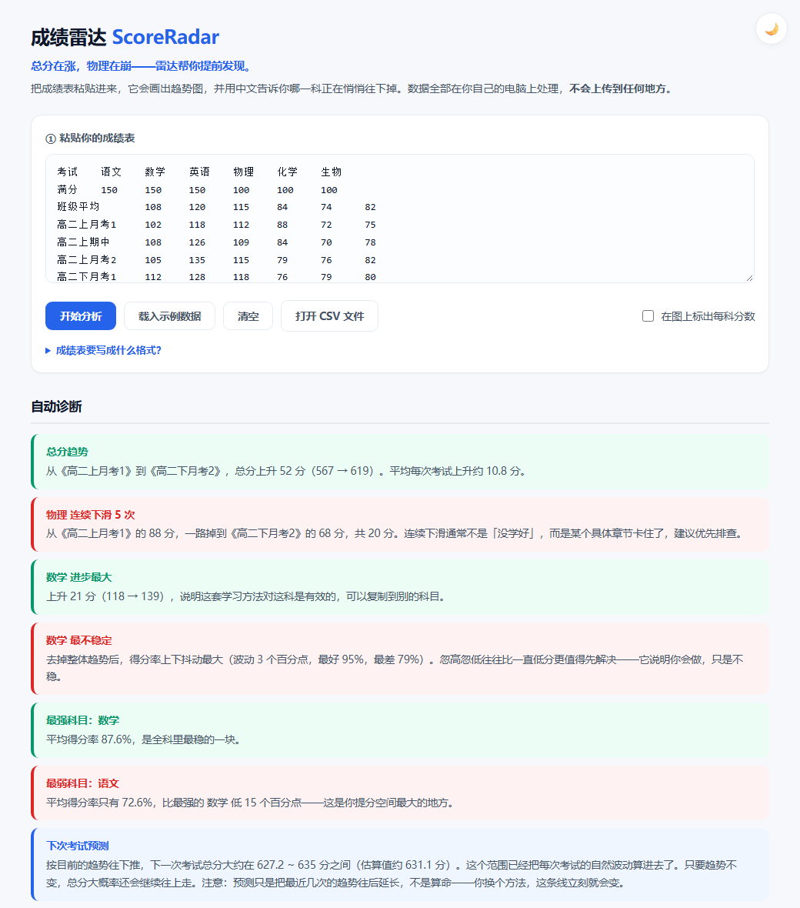
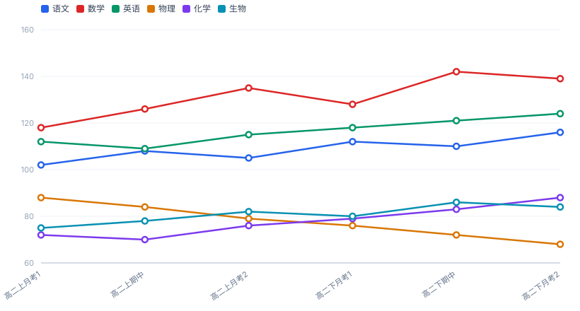
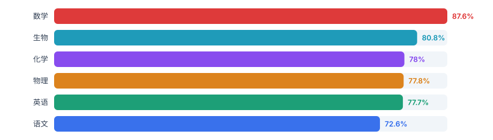
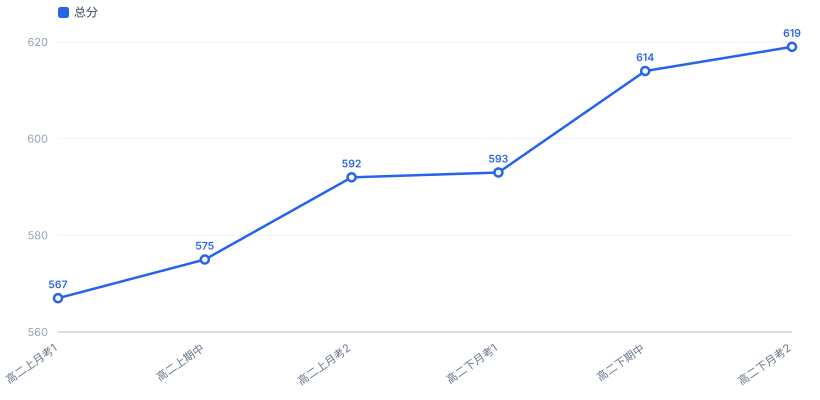

# 成绩雷达 · ScoreRadar

[](https://github.com/ATYC1314/score-radar/actions/workflows/test.yml)
[](LICENSE)
[](https://atyc1314.github.io/score-radar/)

> **总分在涨，物理在崩——雷达帮你提前发现。**

把成绩表粘贴进去，它画出趋势图，并用中文告诉你哪一科正在悄悄往下掉。

不需要安装任何东西，不需要联网，数据全部在你自己的电脑上处理。

### 👉 [**点这里直接打开在线版**](https://atyc1314.github.io/score-radar/)（不用下载，打开就能用）



---

## 为什么要做这个

大部分学生看成绩的方式是：**只看总分和排名**。

但总分是最会骗人的东西。总分涨了 50 分，可能是因为数学猛涨了 30 分，同时物理已经连着掉了 20 分——而后者才是真正需要你立刻处理的事。等到总分终于被物理拖下来的时候，一个学期已经过去了。

这个工具就是为了解决这一件事：**把"总分涨了"拆开，指出究竟是哪一科在退步、退了多久、退了多少。**

比如上面那张截图里，它给出的结论是：

> **总分趋势**：从《高二上月考1》到《高二下月考2》，总分上升 52 分（567 → 619）。平均每次考试上升约 10.8 分。
>
> **物理 连续下滑 5 次**：从《高二上月考1》的 88 分，一路掉到《高二下月考2》的 68 分，共 20 分。连续下滑通常不是「没学好」，而是某个具体章节卡住了，建议优先排查。
>
> **数学 最不稳定**：去掉整体趋势后，得分率上下抖动最大（波动 3 个百分点，最好 95%，最差 79%）。忽高忽低往往比一直低分更值得先解决——它说明你会做，只是不稳。

总分在涨，但物理在崩——这就是只看总分绝对发现不了的东西。

---

## 快速开始

**方式一：直接在线用（推荐，什么都不用装）**

👉 **<https://atyc1314.github.io/score-radar/>**

打开就能用，也可以把这个网址发给同学。

**方式二：下载到本地用（断网也能用）**

1. 下载这个项目（点右上角绿色的 **Code → Download ZIP**，解压）
2. **双击 `index.html`**
3. 从 Excel 里选中你的成绩区域，`Ctrl+C`，粘贴进文本框
4. 点「开始分析」

就这样，没有第 5 步。不用装 Python，不用装 Node，不用敲命令行。

> 两种方式效果完全一样。因为整个工具只有一个网页文件，所有计算都在你的浏览器里完成——**在线版也不会把你的成绩传到任何服务器**。

---

## 成绩表要写成什么格式

第一行是表头，之后每一行是一次考试，**按时间从早到晚排列**。

```
考试,语文,数学,英语,物理,化学,生物
满分,150,150,150,100,100,100
高二上月考1,102,118,112,88,72,75
高二上期中,108,126,109,84,70,78
高二上月考2,105,135,115,79,76,82
高二下月考1,112,128,118,76,79,80
高二下期中,110,142,121,72,83,86
高二下月考2,116,139,124,68,88,84
```

分隔符用 **Tab、逗号、中文逗号、或两个以上空格** 都可以，程序会自动识别——所以你直接从 Excel 复制粘贴（Tab 分隔）就行，不用手动改成逗号。

**「满分」那一行是可选的，但强烈建议填。** 因为语文满分 150、物理满分 100，直接比原始平均分是不公平的。填了满分，程序才能算出「得分率」来做公平的跨科比较，并解锁最强/最弱科目排名和稳定性分析。

如果某一科**缺考，就把那一格留空**，不要写 0 分。程序会跳过它，并把折线断开——0 分会把趋势彻底带偏。

---

## 图表

分析完会生成三张图：

**各科趋势** —— 一眼看出哪条线在往下走。点科目名可以单独隐藏/显示某几科，方便只看你关心的。



**各科平均得分率** —— 公平地横向比较各科强弱（已按满分折算）。



**总分趋势** —— 整体走势，每个点标出具体分数。



---

## 生成图片和报告文件

如果你想把图表贴进 Word 或 PPT：

```bash
node tools/export-svg.js sample-data.csv out
```

它会在 `out/` 目录下生成：

- `总分趋势.svg`、`各科趋势.svg`、`各科得分率.svg` —— 矢量图，放大不糊，可直接插入 Word/PPT
- `分析报告.html` —— 一份完整的网页报告，双击即可打开
- 同时会在终端里把诊断结论打印一遍

需要先装 [Node.js](https://nodejs.org/)（只有这个功能需要，日常使用不需要）。

---

## 它是怎么工作的

```
score-radar/
├── index.html              界面（打开这一个文件就能用）
├── core.js                 核心逻辑：解析 → 统计 → 诊断 → 画图
├── test.js                 自动测试（88 项）
├── sample-data.csv         示例数据
├── tools/export-svg.js     命令行导出工具
└── docs/                   README 用到的图片
```

`core.js` 里没有任何界面代码，只有四组纯函数：

| 函数 | 干什么 |
|---|---|
| `parseTable(text)` | 把粘贴的文本变成数据，自动识别分隔符、全角数字、缺考空格 |
| `trendStats(values)` | 算趋势：涨了多少、斜率、标准差、最长连续下滑、从最高点回落多少 |
| `diagnose(dataset)` | 把上面那些数字翻译成人话 |
| `lineChartSVG(opt)` | 手写 SVG 画折线图，**不依赖任何第三方图表库** |

整个项目 **零依赖**——没有 npm 包，没有 CDN，没有构建步骤。所以十年后它大概率还能跑。

### 两个值得一提的细节

**「连续下滑」必须是真的连续。** 如果中间缺考一次，那就不算连续——中间那一格是空的，你根本不知道到底涨了还是跌了，凭什么说它连续下滑？

**「不稳定」不能用普通标准差判断。** 一个一路匀速下滑的科目，它的标准差也很大，但它显然不是"忽高忽低"，而是"一直在退步"。所以这里用的是**残差标准差**（去掉整体趋势之后剩下的抖动），这样才能把这两件事分开。这个 bug 在开发时真的踩过，现在由 `test.js` 里的回归测试守着。

---

## 开发

项目只有一个依赖要求：Node.js（用来跑测试）。核心逻辑本身不需要任何东西。

```bash
node test.js
```

```
全部通过： 88 项
```

测试覆盖了：解析各种格式、全角数字、缺考处理、连续下滑的识别、残差标准差的正确性、SVG 转义（防止科目名里的 `<` 破坏图片）、以及几个曾经踩过的坑。

---

## 已知限制 / 可以做但还没做的

欢迎提 Issue 或 PR。这些是已知可以做但还没做的事：

- [ ] **导入 Excel (.xlsx)** —— 目前要复制粘贴，或者先存成 CSV
- [ ] **导出成图片** —— 现在要跑命令行才能拿到 SVG
- [ ] **多人的成绩对比** —— 比如和班级平均分比
- [ ] **成绩预测** —— 按目前趋势，下次考试大概考多少分
- [ ] **知识点维度** —— 现在只能按科目，没法细分到"函数"、"电磁感应"这种章节
- [ ] **记住上次的数据** —— 现在关掉页面就没了（不想用 localStorage 存隐私数据，需要想个更好的方案）

---

## 隐私

这个工具**没有任何网络请求**。没有统计代码，没有 CDN，没有后端服务器。你的成绩数据从头到尾只存在于你自己的浏览器里。

你可以自己按 `F12` 打开开发者工具，切到 Network 面板，会看到它是空的。

---

## License

[MIT](LICENSE) —— 随便用，随便改，随便商用。
